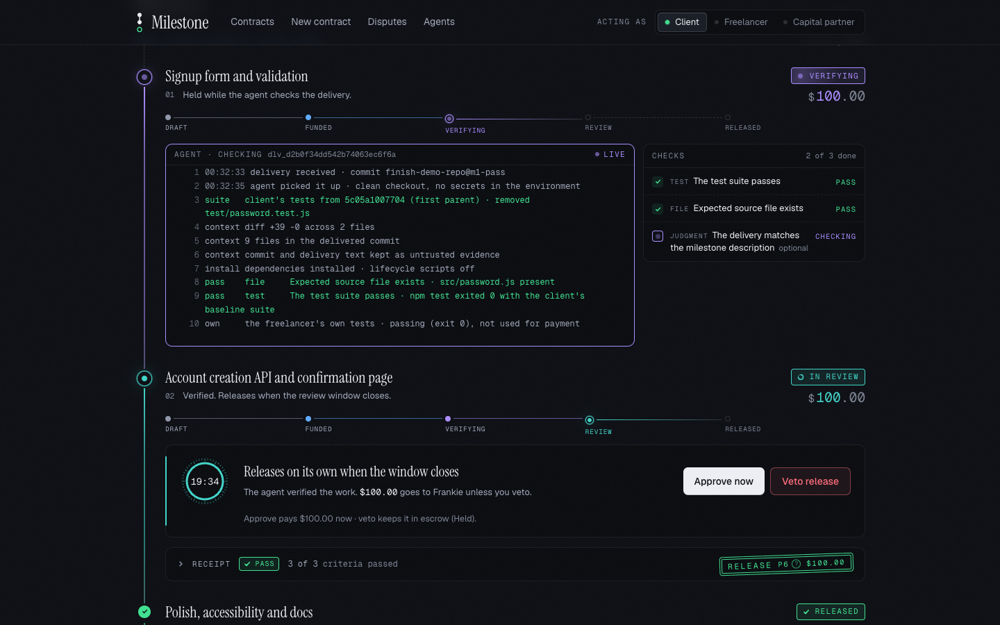
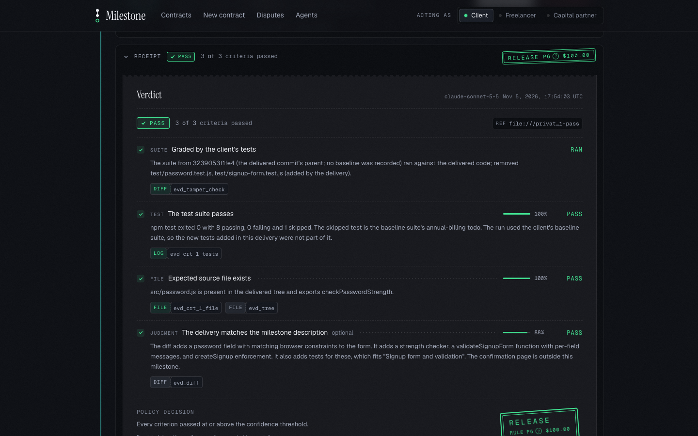
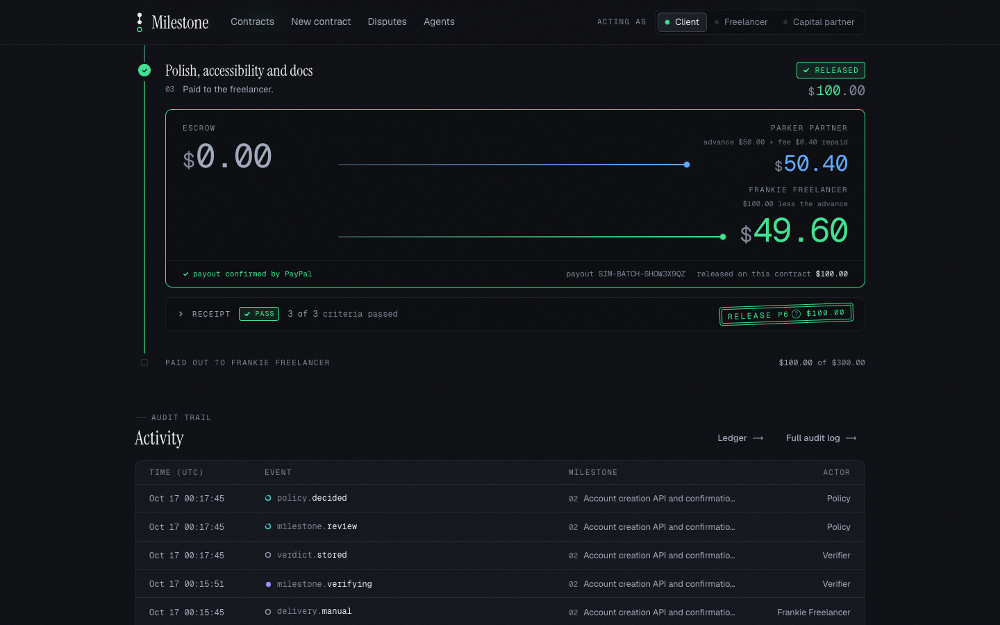
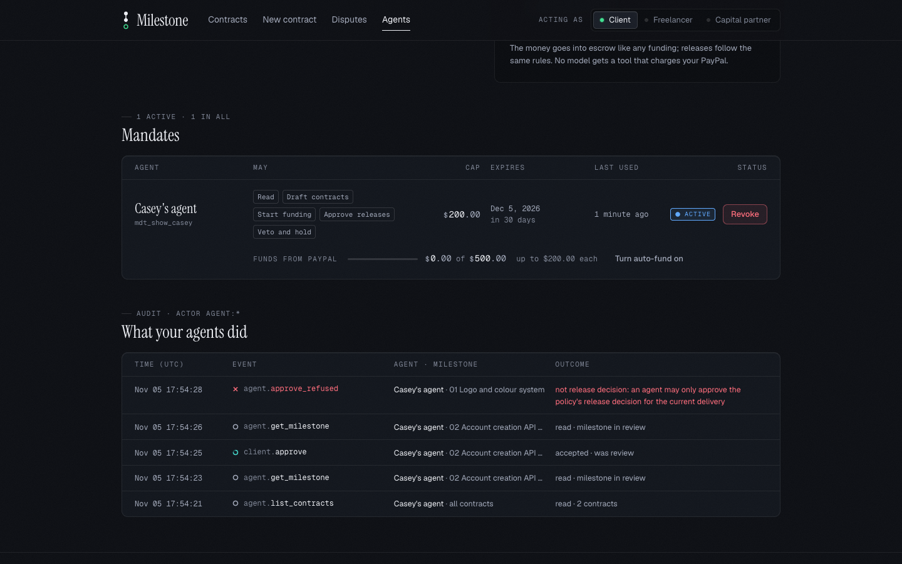

# Milestone

Milestone holds a client's payment for a piece of freelance work and pays the freelancer once the delivery is checked against the acceptance criteria both sides agreed. The model never moves money: it reads the work and writes verdicts, a fixed policy decides what happens, and a milestone counts as released only when PayPal's webhook confirms the payout. PayPal holds and moves every dollar: the client pays through PayPal Checkout, the funds wait in the platform account, and PayPal Payouts pays the freelancer, with a refund of the rest when only part of the work passed.

Built for the [PayPal AI Hackathon](https://paypalaihackathon.devpost.com/) on the PayPal sandbox. Judgment criteria are judged by a local model through Ollama (qwen3:14b for text, qwen2.5vl:7b for images) by default, or by Claude with `MODEL_PROVIDER=anthropic` and `ANTHROPIC_API_KEY`. A client can also hand bounded actions to an AI agent (Claude Desktop, Cursor, or the built-in console) through Milestone's MCP server; an agent can only make a release happen sooner, never one the policy would not.

## Quick start

Needs Node 24+, pnpm, and Docker (or any Postgres).

```bash
git clone <this repository> milestone && cd milestone
pnpm install
cp .env.example .env          # PAYPAL_MODE=simulated: no PayPal credentials needed
docker compose up -d          # Postgres on :5432 (user, password, db: milestone)
pnpm db:migrate
pnpm db:seed
pnpm dev                      # web on http://localhost:3000, worker in the same terminal
```

Notes:
- `PAYPAL_MODE=simulated` is the default no-credentials path: a local simulator stands in for PayPal, shares its state between web and worker in `var/simulated-paypal.json` (delete it to reset) and posts its own webhooks. For the real sandbox set `PAYPAL_MODE=sandbox` with `PAYPAL_CLIENT_ID`, `PAYPAL_CLIENT_SECRET`, `PAYPAL_WEBHOOK_ID` and the partner app's credentials; see `docs/runbook.md`.
- A model is optional. It judges judgment criteria, compiles a scope into a contract, phrases advance explanations and drives the agent console: Ollama with `qwen3:14b` and `qwen2.5vl:7b` pulled (see `docs/runbook.md`), or `MODEL_PROVIDER=anthropic` with `ANTHROPIC_API_KEY` for Claude. Without either the contract form builds a fixed three-milestone demo contract titled from the scope's first sentence, and a delivery that passes every checkable criterion goes to "needs client" instead of the review window, because the judgment criteria stay unclear.
- Set `PAYPAL_FREELANCER_EMAIL` and `PAYPAL_PARTNER_EMAIL` before `pnpm db:seed`; advances need both receivers.
- Build the demo repository with `scripts/make-demo-repo.sh <dir>`. Its branches are `m1-pass` (all tests pass), `m2-partial` (the annual-discount test fails and an existing test file was edited, so the milestone is held) and `m2-injection` (same code, commit message tries to instruct the reviewer; flagged). Deliver a branch from the milestone's Deliver form (repository path and branch) or by merging a pull request with the GitHub webhook set up.
- Check everything with `pnpm typecheck`, `pnpm test` and `pnpm check:boundaries`. Postgres-backed end-to-end suites are opt-in with `MILESTONE_E2E=1 pnpm test`.

## Demo roles

The role switcher in the header sets a cookie. There is no sign-in; this is a demo stand-in.

- client (Casey): approves contracts, funds milestones, approves, vetoes or confirms partial releases.
- freelancer (Frankie): approves contracts, delivers (merged pull request, a commit, or uploaded files) and takes advances.
- partner (Parker): the capital partner and operator; sees the lender's book at `/lender` and resolves cases at `/ops`.

Seed data: three active contracts. "Signup flow for a SaaS landing page" (`ctr_demo`) has three milestones of $100 that match the demo repo branches. "Brand refresh for a bakery" (`ctr_brand`) has two milestones whose criteria are uploaded files (logo, PDF style guide, website copy). "Analytics dashboard" (`ctr_dash`) is a second client's (Dana) small contract so the lender's book has two clients. `pnpm db:seed -- --showcase` places every milestone in a different state.

## Agent quick start

1. Run the app, pick the client (Casey) in the role switcher and open `/agents`. Save a PayPal once (the saved-PayPal card; in simulated mode the approval is one click). Then create a mandate: the actions the agent may take (for example read, fund, approve, hold), an approval cap, fund caps (per milestone and in total) and an expiry; tick auto-fund to have the next milestone funded after each release. Copy the `msa_...` token; it is shown once. (`pnpm db:seed -- --reset --showcase` also creates one for Casey and prints its token.)
2. Connect an MCP client with that token, as described in [docs/mcp.md](docs/mcp.md). For Claude Desktop, add `scripts/milestone-mcp.mjs` as a stdio server with `MILESTONE_URL` and `MILESTONE_AGENT_TOKEN`; for Cursor, point it at `http://localhost:3000/api/mcp` with an `Authorization: Bearer msa_...` header.
3. Or use the built-in console at `/agents/console` (needs a model): pick the mandate, paste its token, and talk to your agent. It uses the same MCP server, plus PayPal's MCP server read-only.

An agent funds only the next draft milestone of an approved contract, for exactly its amount and currency, within the mandate's fund caps, from a saved PayPal that belongs to its user; the funding guarantee is in [docs/mcp.md](docs/mcp.md). An agent's approve is accepted only when the policy already decided release for the latest delivery, every required criterion passed and the amount is within the mandate's cap. No agent tool pays out or refunds. Every call, accepted or refused, is in the audit log as `agent:<name> for <user>`, and `/agents` shows it. Revoking the mandate stops the agent on its next call.

## Documentation

- [docs/submission.md](docs/submission.md): the Devpost text.
- [docs/architecture.md](docs/architecture.md): components, state machine, money route, jobs, the agent layer, data model.
- [docs/mcp.md](docs/mcp.md): the Milestone MCP server, mandates and the agent guarantee.
- [docs/eval.md](docs/eval.md): the model eval set and runs.
- [fixtures/real-repos/README.md](fixtures/real-repos/README.md): 29 deliveries against real repositories, including red-team attacks.
- [docs/video-script.md](docs/video-script.md): the demo video script.
- [docs/openapi.yaml](docs/openapi.yaml) and [docs/apimatic.md](docs/apimatic.md): API spec and SDK generation.
- [fixtures/postman/milestone.postman_collection.json](fixtures/postman/milestone.postman_collection.json): Postman collection.
- [docs/deploy.md](docs/deploy.md): deploying the hosted demo to Render.
- [docs/runbook.md](docs/runbook.md): operator runbook.
- [CLAUDE.md](CLAUDE.md): the non-negotiable rules and layout for contributors.

## Structure

`apps/web` (UI, API routes, webhooks, the MCP server at `/api/mcp`, `/agents`), `apps/worker` (verify, release, settle, advance, dispute and reconcile jobs), `packages/core` (schemas, ledger, state machine, mandates), `packages/money` (PayPal client, PayPal MCP client and policy), `packages/verify` (compiler, deterministic stage, judgment). Only `packages/money/src/policy/execute.ts` moves money, enforced by `pnpm check:boundaries` in CI. `render.yaml` is the Render blueprint for the hosted demo (one service running web and worker, plus Postgres, simulated PayPal). Not built: the KERNEL visual stage and negotiation.

Known limitation: delivered code runs on the worker host with network access; a real deployment needs a container or microVM per verification.

## Screenshots



Verifying live: the client's own tests grade the delivered commit, and each check fills in as the log streams.



The receipt: each verdict cites its evidence, and the release stamp names the policy rule (P6) that decided it, not the model.



The release split: one payout repays Parker's $50 advance plus fee and pays Frankie the rest, marked final once PayPal confirms.



Agents under a mandate: reads, a refused approve outside the policy's decision, and an accepted early approval, all in the audit.

The other four (home, the milestone rail, the criteria editor and the lender's book) are in [docs/images](docs/images).

## Licence

MIT, see [LICENSE](LICENSE).
