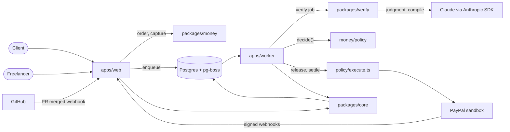
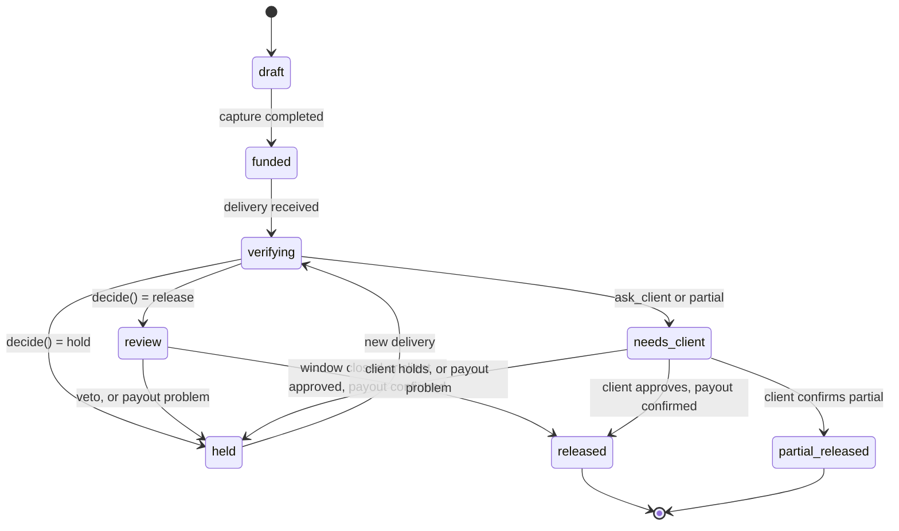

# Architecture

## Components

- `apps/web`: Next.js App Router. UI, HTTP routes, the PayPal and GitHub webhook receivers. Creates orders and captures them, records approvals and client responses, enqueues jobs. Never calls the model.
- `apps/worker`: pg-boss consumers for the jobs `verify`, `release`, `settle`, `advance`.
- `packages/core`: zod schemas, Drizzle schema and migrations, the milestone state machine, the ledger, the idempotency helpers (`requestIdFor`, `storeWebhookOnce`), the job queue.
- `packages/money`: `paypal/` is the REST client (orders, capture, payouts, refunds, invoicing, webhook verification). `policy/` holds `decide()` (pure), `applyReviewWindow()`, `priceAdvance()` and `execute.ts`, the only module that moves money.
- `packages/verify`: contract compiler, deterministic stage with the tamper check, injection pre-pass, the judgment stage and parser, PR comment formatter, explanations. All model calls go through `llm.ts`. It never imports `@milestone/money`.
- Postgres: application tables, the job queue (pg-boss) and locks.

Boundaries enforced by `pnpm check:boundaries`: only `packages/money` talks to PayPal, only `policy/execute.ts` imports `paypal/money.ts`, and `packages/verify` does not import `@milestone/money`.

## The milestone state machine

From `TRANSITIONS` in `packages/core/src/milestones.ts`. There are seven working states plus `draft`. `transition()` refuses any other move, writes the audit entry in the same call, and is a no-op when the milestone is already in the target state.

| From | To |
| --- | --- |
| draft | funded |
| funded | verifying |
| verifying | review, held, needs_client |
| review | released, held |
| held | verifying |
| needs_client | released, partial_released, held |
| released, partial_released | none (terminal) |

A milestone flagged `milestone.needs_operator` stays in `held`: a new delivery is refused (`verify.refused_needs_operator`) and the release job refuses to run again.

## Policy rules

`decide()` runs rules in order; the first match wins. P0: no criteria, ask the client. P1: suspected injection, ask the client. P2: a required criterion failed, hold. P3: any criterion unclear, or lowest confidence under the threshold (default 0.80), ask the client. P4: amount above the per-release cap, ask the client. P5: an optional criterion failed, partial with a share proportional to criteria passed. P6: release. The review window can only make a decision more conservative (`RW-veto`, `RW-open`) or let a release through.

## The money route

1. `POST /api/milestones/{id}/order` creates a PayPal order (`POST /v2/checkout/orders`) with the milestone id as `reference_id`. The request id comes from a `paypal_ops` row, so repeated clicks get the same order.
2. The JS SDK approves it; `POST /api/milestones/{id}/capture` captures it into the platform account. The `CHECKOUT.ORDER.APPROVED` and `PAYMENT.CAPTURE.COMPLETED` webhooks reach the same idempotent code. The amount is checked, the capture id is recorded, the ledger posts client to held, the milestone becomes `funded`, and the default branch head is saved as the tamper baseline.
3. Release: the release job claims the payout `paypal_ops` row under a row lock, then calls `POST /v1/payments/payouts`.
4. Partial: payout of the released share, then `POST /v2/payments/captures/{id}/refund` for the rest.
5. Settle: `PAYMENT.PAYOUTS-ITEM.*` and `PAYMENT.CAPTURE.REFUNDED` webhooks enqueue the settle job, which posts the ledger, moves the milestone to `released` or `partial_released`, and issues a paid receipt invoice.
6. Advances (planned): a payout from the capital partner's account, repaid from the release.

## Jobs

- `verify`: deterministic stage, judgment stage, store the verdict, `decide()`, move to review, held or needs_client, schedule the release at the end of the window, comment on the PR. Safe to retry at every step.
- `release`: re-derives the outcome from the database under the milestone row lock, applies the review window, claims the payout op, calls PayPal. One attempt per milestone, with a 120 second lease for a crashed claimer.
- `settle`: handles PayPal webhook events for payouts and refunds; confirms release, flags failures, reversals and failed refunds for an operator, repays advances, issues the receipt.
- `advance`: planned. The handler exists and throws "not written yet".

Jobs are sent with `enqueue(name, milestoneId, data, { dedupe, delaySeconds })`; the dedupe key makes a repeat a no-op. Retries use 5 attempts with backoff.

## The verification path

1. The GitHub webhook (HMAC checked, stored once by delivery id) turns a merged pull request from a branch named `m<seq>-...` into a delivery and a verify job.
2. The deterministic stage clones the commit, removes committed `node_modules`, installs with `--ignore-scripts`, runs the test, build and file criteria, and runs the tamper check against the baseline.
3. The judgment stage gives Claude the criteria, evidence summaries and delivery text inside delimited untrusted blocks, with read-only tools (`read_file`, `get_diff`, `list_evidence`, `view_screenshot`, `view_file`).
4. `enforce()` makes deterministic results win, drops unknown evidence ids and downgrades evidence-free passes. `overall()` computes pass, partial or fail from the criteria.

Not built yet: the visual stage (`visual.ts` is a stub), and HTTP routes for manual or upload deliveries (the schema has `deploy_url`, `manual` and `upload` sources and the upload criterion checker, but only the GitHub webhook creates deliveries).

## Data model

Ten tables in `packages/core/src/schema.ts`; no tables have been added to them.

- `users`: role (client, freelancer, partner, platform), PayPal email, GitHub login.
- `contracts`: parties, scope text, currency, total, per-release cap, confidence threshold, review window, repo, status, approval times.
- `milestones`: seq, amount, status, PayPal order and capture ids, baseline sha, current decision, review end, client response, advance eligibility.
- `criteria`: kind, description, spec, required.
- `deliveries`: source, ref, payload, evidence, verdict, result, injection flag, model, prompt hash.
- `advances`: partner, principal, fee, status, offer, explanation.
- `paypal_ops`: kind, key, request id (unique), PayPal id, status, request, response. Unique on (kind, key).
- `webhook_events`: source, event id, type, payload, processed time. Unique on (source, event_id).
- `ledger_entries`: transaction id, account, amount in minor units, currency, debit or credit, ref. Balances are derived; each `txn_id` sums to zero.
- `audit_log`: append-only; actor, event, detail, contract and milestone ids.

Money is integer minor units plus currency throughout.
