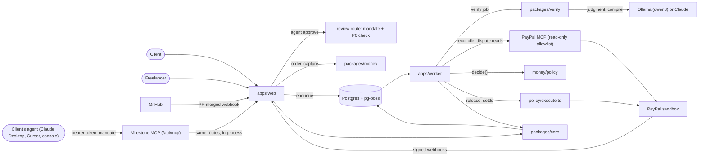
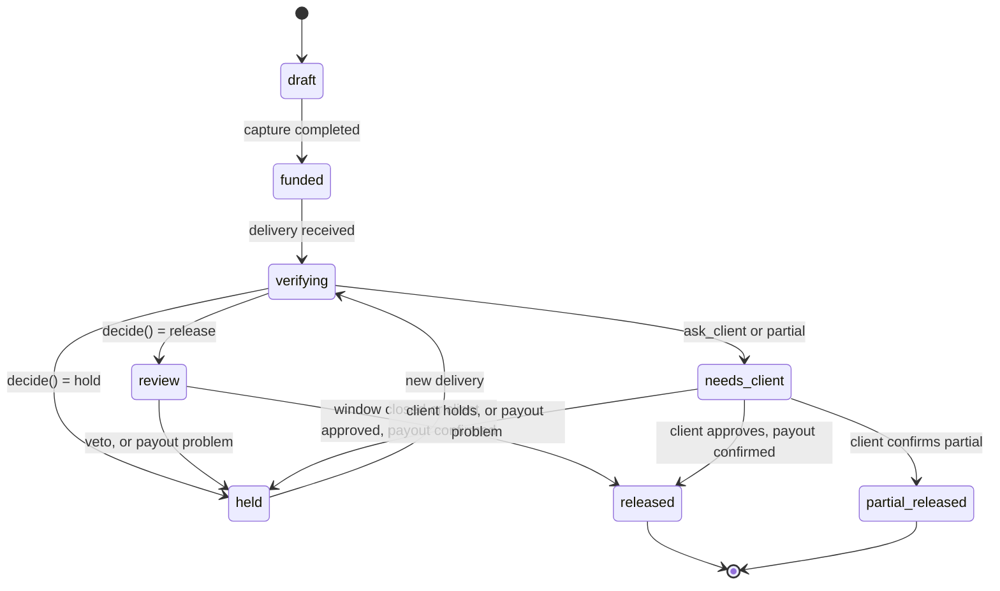

# Architecture

## Components

- `apps/web`: Next.js App Router. UI, HTTP routes, the PayPal and GitHub webhook receivers. Creates orders and captures them, records approvals and client responses, receives manual and upload deliveries, prices and accepts advances, enqueues jobs. It calls the model to phrase an advance offer's explanation and to drive the agent console.
- `apps/worker`: pg-boss consumers for the jobs `verify`, `release`, `settle`, `advance`, `dispute` and `reconcile`.
- `packages/core`: zod schemas, Drizzle schema and migrations, the milestone state machine, the ledger, the idempotency helpers (`requestIdFor`, `storeWebhookOnce`), the job queue.
- `packages/money`: `paypal/` is the REST client (orders, capture, payouts, refunds, invoicing, disputes, webhook verification), `mcp-client.ts` (PayPal's MCP server, read-only, see below) and `simulated.ts`, the local stand-in used when `PAYPAL_MODE=simulated`. `policy/` holds `decide()` (pure), `applyReviewWindow()`, `priceAdvance()` and `execute.ts`, the only module that moves money.
- `packages/verify`: contract compiler, deterministic stage with the baseline suite and the gaming scan (`gaming.ts`), upload stage (`upload-checks.ts`), injection pre-pass, the judgment stage and parser, PR comment formatter, explanations. All model calls go through `llm.ts`. It never imports `@milestone/money`.
- Postgres: application tables, the job queue (pg-boss) and locks.

The agent layer:

- Mandates (`packages/core/src/mandates.ts`, table `agent_mandates`): a user delegates a list of actions to a named agent, with an approval cap in minor units and a currency, an expiry (at most 90 days) and a revocation time. The bearer token (`msa_...`) is shown once and stored as its sha256. `mandateAllows()` is a pure check of what the user delegated; it fails closed on anything missing or malformed. Mandates are created, listed and revoked through `/api/agents`, which refuses any request that carries an `Authorization` header, so an agent cannot change its own mandate.
- Milestone MCP server (`POST /api/mcp`, `apps/web/src/lib/mcp/`): Streamable HTTP, stateless, bearer token on every request, plus the stdio bridge `scripts/milestone-mcp.mjs` for Claude Desktop. Its seven tools call the existing route handlers in-process (`lib/mcp/routes.ts`), so no route logic is copied. Freelancer text in tool results sits inside an `untrusted` field. See `docs/mcp.md`.
- Agent console and `/agents` (`apps/web/src/app/agents/`, `apps/web/src/lib/agent/`): `/agents` creates and revokes mandates and shows every agent action, accepted or refused. `/agents/console` is the client's agent in conversation: the configured model in a tool loop, connected to Milestone MCP with the mandate's token and to PayPal MCP with `list_transactions` only. Tools whose names look like money movement are never offered to the model, whatever a server lists (`lib/agent/tools.ts`, `MONEY_TOOL`).
- PayPal MCP reconciler (`packages/money/src/paypal/mcp-client.ts`, `apps/worker/src/jobs/reconcile.ts`): the worker starts `@paypal/mcp` over stdio with only the read groups (`transactions.list`, `disputes.list`, `disputes.get`). `callPayPalTool()` refuses any tool outside `PAYPAL_MCP_ALLOWED_TOOLS` before anything is sent, and a session whose server exposes a money tool is refused. The `reconcile` job (queued from `/ops`) matches `list_transactions` against `paypal_ops` and the ledger and writes one `ops.reconciled` audit row; mismatches show on `/ops` and no milestone changes state. The `dispute` job reads the dispute with `get_dispute`, falling back to REST. In simulated mode the same tools answer from the simulator's state, labelled `simulated: true`.

Boundaries enforced by `pnpm check:boundaries`: only `packages/money` talks to PayPal, only `policy/execute.ts` imports `paypal/money.ts`, and `packages/verify` does not import `@milestone/money`.

## The milestone state machine

From `TRANSITIONS` in `packages/core/src/milestones.ts`. There are seven working states plus `draft`. `transition()` refuses any other move, writes the audit entry in the same call, and is a no-op when the milestone is already in the target state.

| From | To |
| --- | --- |
| draft | funded |
| funded | verifying |
| verifying | review, held, needs_client |
| review | released, held |
| held | verifying |
| needs_client | released, partial_released, held |
| released, partial_released | none (terminal) |

A milestone flagged `milestone.needs_operator` stays in `held`: a new delivery is refused (`verify.refused_needs_operator`) and the release job refuses to run again.

## The agent guarantee

An agent can only make a release happen sooner, never one the policy would not. It is enforced in one place, the review route (`apps/web/src/app/api/milestones/[id]/review/route.ts`); the MCP tool `respond_to_review` forwards the agent's bearer token to that route and checks nothing of its own. With an `Authorization: Bearer` header the route resolves the mandate (401 `invalid_token`, 403 `mandate_expired` or `mandate_revoked`), then, inside the milestone's transaction:

1. re-reads the mandate `FOR SHARE`, so a concurrent revoke either lands first and refuses the call or waits for it;
2. checks `mandateAllows()` for the action (`approve` for approve, `hold` for veto or hold) with the amount, `max(milestone amount, decision amount)`, in the contract's currency (403 `mandate_missing_action`, `mandate_cap_exceeded`);
3. for approve, requires the milestone in `review` with the stored decision being the policy's own release (P6) for the latest delivery (409 `not_release_decision`) and every required criterion passed (409 `required_criteria_not_passed`). `confirm_partial` is never an agent's.

Accepted and refused calls are audited with the actor `agent:<name> for <user>`. Without an agent the release still happens when the review window closes, so an accepted approve only moves it earlier. No agent path captures, pays out or refunds: `fund_milestone` returns PayPal's approval link for a human. Tests: `apps/web/test/review-agent.test.ts`, `apps/web/test/mcp.test.ts`, `packages/core/test/mandates.test.ts`.

## Policy rules

`decide()` runs rules in order; the first match wins. P0: no criteria, ask the client. P1: suspected injection, ask the client. P2: a required criterion failed, hold. P3: any criterion unclear, or lowest confidence under the threshold (default 0.80), ask the client. P4: amount above the per-release cap, ask the client. P5: an optional criterion failed, partial with a share proportional to criteria passed. P6: release. The review window can only make a decision more conservative (`RW-veto`, `RW-open`) or let a release through.

## The money route

1. `POST /api/milestones/{id}/order` creates a PayPal order (`POST /v2/checkout/orders`) with the milestone id as `reference_id`. The request id comes from a `paypal_ops` row, so repeated clicks get the same order.
2. The JS SDK approves it; `POST /api/milestones/{id}/capture` captures it into the platform account. The `CHECKOUT.ORDER.APPROVED` and `PAYMENT.CAPTURE.COMPLETED` webhooks reach the same idempotent code. The amount is checked, the capture id is recorded, the ledger posts client to held, the milestone becomes `funded`, and the default branch head is saved as the baseline for the client's test suite.
3. Release: the release job claims the payout `paypal_ops` row under a row lock, then calls `POST /v1/payments/payouts`.
4. Partial: payout of the released share, then `POST /v2/payments/captures/{id}/refund` for the rest.
5. Settle: `PAYMENT.PAYOUTS-ITEM.*` and `PAYMENT.CAPTURE.REFUNDED` webhooks enqueue the settle job, which posts the ledger, moves the milestone to `released` or `partial_released`, and issues a paid receipt invoice.
6. Advances: the freelancer accepts an offer on a funded milestone, the advance job pays the principal from the capital partner's PayPal account (`fundAdvance`), and the release job later pays the partner first (principal plus the quoted fee) and the freelancer the rest.

### Simulated PayPal

`PAYPAL_MODE=simulated` (also the default when `PAYPAL_CLIENT_ID` is empty outside production) swaps the PayPal client for `paypal/simulated.ts`, a `fetch` implementation that answers the REST calls Milestone makes with sandbox-shaped JSON. It replays the first success for a repeated `PayPal-Request-Id`, keeps all state in `var/simulated-paypal.json` (shared by web and worker, written under a lock file; delete it to reset) and posts the matching webhook events (capture, payout item, refund) to `APP_URL/api/webhooks/paypal` about 1.5 seconds later with an `X-Milestone-Simulated` header carrying `SIMULATED_WEBHOOK_SECRET` (default `dev` outside production). In simulated mode the webhook route accepts only that header; in sandbox mode only PayPal's signature. The order's approve link points at `/api/dev/paypal/approve`, and `/api/dev/paypal/fail` arms a one-shot payout failure. Those routes answer 404 in sandbox mode. The capital partner has its own simulated account.

## Jobs

- `verify`: deterministic stage, judgment stage, store the verdict, `decide()`, move to review, held or needs_client, schedule the release at the end of the window, comment on the PR. Safe to retry at every step.
- `release`: re-derives the outcome from the database under the milestone row lock, applies the review window, claims the payout op, calls PayPal. When the milestone or an earlier one of the freelancer's has a funded advance, the payout batch pays the partner first. One attempt per milestone, with a 120 second lease for a crashed claimer.
- `settle`: handles PayPal webhook events for payouts and refunds; confirms release, flags failures, reversals and failed refunds for an operator, repays advances, issues the receipt.
- `advance`: pays an accepted advance (`offered`) from the capital partner's PayPal account, under row locks on the advance and milestone, with the payout claimed in a `paypal_ops` row first so a retry replays the same request id. Posts the ledger entry (partner receivable debit, partner cash credit), sets the advance `funded` and audits `advance.funded`. It refuses if the milestone is past `verifying` or the release payout is already claimed: an unsent advance is withdrawn (`advance.withdrawn`), one that may already have been paid is flagged `advance.needs_operator` and never touched again. Repayment happens in the release and settle jobs, which move the advance to `repaid` or `shortfall`.

Jobs are sent with `enqueue(name, milestoneId, data, { dedupe, delaySeconds })`; the dedupe key makes a repeat a no-op. Retries use 5 attempts with backoff.

## Deliveries

`deliveries.source` has four values. Three are created by routes:

- `github_pr`: the GitHub webhook (HMAC checked, stored once by delivery id) turns a merged pull request from a branch named `m<seq>-...` on a contract's repository into a delivery and a verify job.
- `manual`: `POST /api/milestones/{id}/deliver` with `{ repoUrl, ref }` by the contract's freelancer. The ref is resolved with `git ls-remote` and stored in the same payload shape as the webhook, so the verify job treats it identically.
- `upload`: `POST /api/milestones/{id}/upload`, multipart, up to 10 files of 20 MB. Files are written to `UPLOAD_DIR/<deliveryId>/` (default `var/uploads`) with their sha256; `GET /api/files/{deliveryId}/{name}` serves them to the two parties with a sandboxing CSP.
- `deploy_url` exists in the schema but nothing creates it.

Both route deliveries are allowed while the milestone is `funded` or `held`, and a delivery id is derived from the milestone and commit so a repeat is a no-op.

## The verification path

1. A delivery and a verify job exist (see above).
2. Code deliveries: the deterministic stage clones the commit, removes committed `node_modules`, installs with `--ignore-scripts`, runs the test, build and file criteria, and runs the test criterion against the client's baseline suite (rule 9). The baseline is the default-branch head saved at funding, else the pull request base, else the commit's first parent; an unfetchable baseline fails closed (the delivery's own tests run and a pass is recorded `unclear`). Before setup the stage restores the baseline's test files, runner config, package-manager config, lockfiles and the files its scripts name, keeps the baseline's `package.json` scripts and dev dependencies, and removes test files and configs the delivery added. A delivery that edits tests is not distrusted; its edits just do not run, and `evd_tamper_check` lists what was restored or removed. The delivery's own tests run afterwards in an informational pass that decides nothing. A gaming scan of the added source lines (runner detection through argv, `require.main` or the stack, `CI` and `NODE_ENV` sniffing, assertion and loader patching in several forms, exits and computed exits, `child_process` in library code) records each hit as `unclear` on the test criterion, so the milestone goes to the client. Policy also sends a new dependency, or a dependency moved to a git, file or tarball source, to the client.
   File deliveries: the upload stage (no model) checks each `upload` criterion against the files matching `spec.pattern` (a glob or extension list): `format` (from magic bytes: pdf, png, jpg, svg, docx, md, txt), `minBytes`, `minWords`, `maxPages`, `minWidth`, `minHeight` and `mustContain`. A criterion passes when one matching file passes every check, is unclear when a check cannot be decided, and fails otherwise. There is no baseline suite or gaming scan because nothing in an upload controls what the checks run.
3. The judgment stage gives the model (Ollama by default, Claude when configured; `packages/verify/src/llm.ts`) the criteria, evidence summaries and delivery text inside delimited untrusted blocks, with read-only tools (`read_file`, `get_diff`, `list_evidence`, `view_screenshot`, `view_file`). With no model available (`isModelConfigured()` is false) the judgment stage is skipped: the model is recorded as `deterministic-only`, judgment criteria are unclear and rule P3 sends a passing delivery to the client.
4. `enforce()` makes deterministic results win, drops unknown evidence ids and downgrades evidence-free passes. `overall()` computes pass, partial or fail from the criteria.

Not built: the KERNEL visual stage (`visual.ts` is a stub) and negotiation. The hosted demo is a Render blueprint, `render.yaml`: one service runs the web app and the worker side by side (`scripts/start-render.mjs`, because the simulator's state and uploads are files both read), plus Postgres.

## Seed contracts

`pnpm db:seed` loads three active contracts; the third, `ctr_dash`, is a second client's small dashboard contract. `ctr_demo` (repo `milestone-demo/landing`, three milestones of $100): each milestone has a required test, a required file (`src/password.js`, `public/pricing.html`, `README.md`) and an optional judgment criterion, matching the demo repo branches `m1-pass`, `m2-partial` and `m2-injection`. `ctr_brand` (a bakery brand refresh, no repository, $90 and $60): `upload` criteria for a logo (`*.{svg,png}`, at least 1024 px wide), a PDF style guide (at most 12 pages, containing "Typography") and website copy (`.md` or `.docx`, at least 600 words, containing "About us"), plus optional judgment criteria. The freelancer's PayPal email comes from `PAYPAL_FREELANCER_EMAIL`, the partner's from `PAYPAL_PARTNER_EMAIL`.

## The operator flow

If a payout item fails, is blocked, returned or reversed, or a refund fails, the release or settle job writes `milestone.needs_operator` and the milestone stays `held`; the release job refuses to run again and a new delivery is refused. The partner opens `/ops`, which lists flagged milestones with the paid, failed, reversed, pending and refunded items and the `paypal_ops` rows, fixes it by hand in PayPal, and records a note with `POST /api/ops/{milestoneId}/resolve` (audit event `ops.resolved`, which clears the card but moves no money). In simulated mode the card also has a "Simulate payout failure" button (`/api/dev/paypal/fail`). Advances have the same pattern with `advance.needs_operator`. See `docs/runbook.md`.

## Data model

Eleven tables in `packages/core/src/schema.ts`.

- `users`: role (client, freelancer, partner, platform), PayPal email, GitHub login.
- `contracts`: parties, scope text, currency, total, per-release cap, confidence threshold, review window, repo, status, approval times.
- `milestones`: seq, amount, status, PayPal order and capture ids, baseline sha, current decision, review end, client response, advance eligibility.
- `criteria`: kind, description, spec, required.
- `deliveries`: source (`github_pr`, `manual`, `upload`, `deploy_url`), ref, payload (commit data, or the stored files with sha256), evidence, verdict, result, injection flag, model, prompt hash.
- `advances`: partner, principal, fee per day, status (`offered`, `funded`, `repaid`, `shortfall`), offer, explanation. One per milestone.
- `paypal_ops`: kind, key, request id (unique), PayPal id, status, request, response. Unique on (kind, key).
- `webhook_events`: source, event id, type, payload, processed time. Unique on (source, event_id).
- `ledger_entries`: transaction id, account, amount in minor units, currency, debit or credit, ref. Balances are derived; each `txn_id` sums to zero.
- `audit_log`: append-only; actor, event, detail, contract and milestone ids.
- `agent_mandates`: user, agent name, token hash, actions, approval cap and currency, expiry, revocation and last-used times.

Money is integer minor units plus currency throughout.
