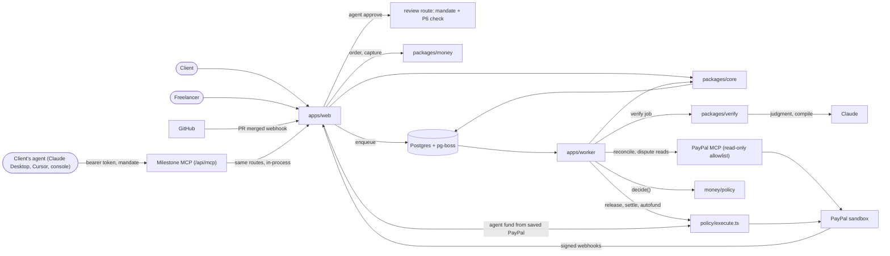
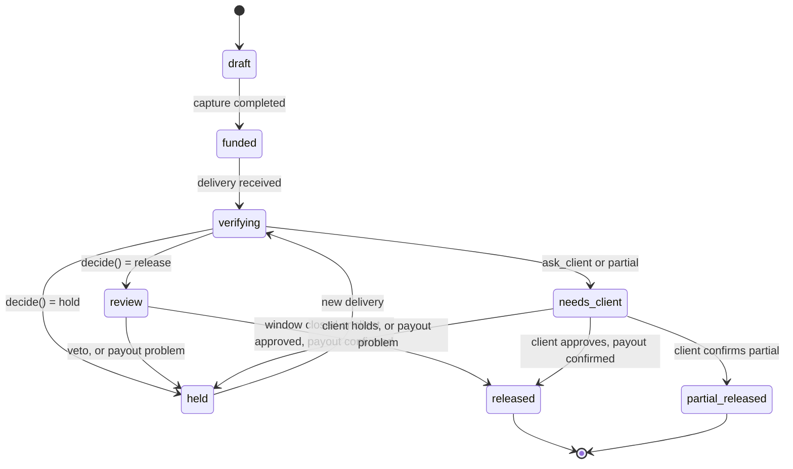

# Architecture

## Components

- `apps/web`: Next.js App Router. UI, HTTP routes, the PayPal and GitHub webhook receivers. Creates orders and captures them, records approvals and client responses, receives manual and upload deliveries, prices and accepts advances, enqueues jobs. It also serves the Milestone MCP server (`/api/mcp`), the mandate and saved-PayPal routes (`/api/agents`, `/api/vault`) and, with `DEMO_MODE=1`, the hosted demo's reset (`/api/demo/reset`). It calls the model to phrase an advance offer's explanation and to drive the agent console.
- `apps/worker`: pg-boss consumers for the jobs `verify`, `release`, `settle`, `advance`, `dispute`, `reconcile`, `autofund` and `aup`.
- `packages/core`: zod schemas, Drizzle schema and migrations, the milestone state machine, the ledger, the idempotency helpers (`requestIdFor`, `storeWebhookOnce`), the job queue.
- `packages/money`: `paypal/` is the REST client (orders, capture, payouts, refunds, invoicing, disputes, the vault's Payment Method Tokens v3, webhook verification), `mcp-client.ts` (PayPal's MCP server, read-only, see below) and `simulated.ts`, the local stand-in used when `PAYPAL_MODE=simulated`. `policy/` holds `decide()` (pure), `applyReviewWindow()`, `priceAdvance()` and `execute.ts`, the only module that moves money.
- `packages/verify`: contract compiler, deterministic stage with the baseline suite and the gaming scan (`gaming.ts`), upload stage (`upload-checks.ts`), injection pre-pass, the judgment stage and parser, PR comment formatter, explanations. All model calls go through `llm.ts`. It never imports `@milestone/money`.
- Postgres: application tables, the job queue (pg-boss) and locks.

The agent layer:

- Mandates (`packages/core/src/mandates.ts`, table `agent_mandates`): a user delegates a list of actions to a named agent, with an approval cap in minor units and a currency, an expiry (at most 90 days) and a revocation time. The bearer token (`msa_...`) is shown once and stored as its sha256. `mandateAllows()` is a pure check of what the user delegated; it fails closed on anything missing or malformed. Mandates are created, listed, revoked and have their funding terms changed through `/api/agents`, which refuses any request that carries an `Authorization` header, so an agent cannot change its own mandate.
- Milestone MCP server (`POST /api/mcp`, `apps/web/src/lib/mcp/`): Streamable HTTP, stateless, bearer token on every request, plus the stdio bridge `scripts/milestone-mcp.mjs` for Claude Desktop. Its seven tools call the existing route handlers in-process (`lib/mcp/routes.ts`), so no route logic is copied. Freelancer text in tool results sits inside an `untrusted` field. See `docs/mcp.md`.
- Agent console and `/agents` (`apps/web/src/app/agents/`, `apps/web/src/lib/agent/`): `/agents` creates and revokes mandates, saves or removes the client's PayPal for agent funding, sets auto-fund, and shows every agent action, accepted or refused. `/agents/console` is the client's agent in conversation: the configured model in a tool loop, connected to Milestone MCP with the mandate's token and to PayPal MCP with `list_transactions` only. Tools whose names look like money movement are never offered to the model, whatever a server lists (`lib/agent/tools.ts`, `MONEY_TOOL`).
- PayPal MCP reconciler (`packages/money/src/paypal/mcp-client.ts`, `apps/worker/src/jobs/reconcile.ts`): the worker starts `@paypal/mcp` over stdio with only the read groups (`transactions.list`, `disputes.list`, `disputes.get`). `callPayPalTool()` refuses any tool outside `PAYPAL_MCP_ALLOWED_TOOLS` before anything is sent, and a session whose server exposes a money tool is refused. The `reconcile` job (queued from `/ops`) matches `list_transactions` against `paypal_ops` and the ledger and writes one `ops.reconciled` audit row; mismatches show on `/ops` and no milestone changes state. The `dispute` job reads the dispute with `get_dispute`, falling back to REST. In simulated mode the same tools answer from the simulator's state, labelled `simulated: true`.

Boundaries enforced by `pnpm check:boundaries`: only `packages/money` talks to PayPal, only `policy/execute.ts` imports `paypal/money.ts`, and `packages/verify` does not import `@milestone/money`.

## The milestone state machine

From `TRANSITIONS` in `packages/core/src/milestones.ts`. There are seven working states plus `draft`. `transition()` refuses any other move, writes the audit entry in the same call, and is a no-op when the milestone is already in the target state.

| From | To |
| --- | --- |
| draft | funded |
| funded | verifying |
| verifying | review, held, needs_client |
| review | released, held |
| held | verifying |
| needs_client | released, partial_released, held |
| released, partial_released | none (terminal) |

A milestone flagged `milestone.needs_operator` stays in `held`: a new delivery is refused (`verify.refused_needs_operator`) and the release job refuses to run again.

## The agent guarantee

An agent can only make a release happen sooner, never one the policy would not. It is enforced in one place, the review route (`apps/web/src/app/api/milestones/[id]/review/route.ts`); the MCP tool `respond_to_review` forwards the agent's bearer token to that route and checks nothing of its own. With an `Authorization: Bearer` header the route resolves the mandate (401 `invalid_token`, 403 `mandate_expired` or `mandate_revoked`), then, inside the milestone's transaction:

1. re-reads the mandate `FOR SHARE`, so a concurrent revoke either lands first and refuses the call or waits for it;
2. checks `mandateAllows()` for the action (`approve` for approve, `hold` for veto or hold) with the amount, `max(milestone amount, decision amount)`, in the contract's currency (403 `mandate_missing_action`, `mandate_cap_exceeded`);
3. for approve, requires the milestone in `review` with the stored decision being the policy's own release (P6) for the latest delivery (409 `not_release_decision`) and every required criterion passed (409 `required_criteria_not_passed`). `confirm_partial` is never an agent's.

Accepted and refused calls are audited with the actor `agent:<name> for <user>`. Without an agent the release still happens when the review window closes, so an accepted approve only moves it earlier. No agent path pays out or refunds; the only charge an agent can cause is the funding guarantee's, below. Tests: `apps/web/test/review-agent.test.ts`, `apps/web/test/mcp.test.ts`, `packages/core/test/mandates.test.ts`.

## The funding guarantee

An agent may fund only (a) a milestone of a contract both parties approved and whose PayPal AUP check is clear, keywords only or cleared by an operator (see below), (b) whose status is `draft`, (c) the next unfunded milestone in sequence, (d) for exactly the milestone amount, (e) in the mandate's currency, (f) within the mandate's per-milestone fund cap and its total fund cap across the mandate's life (the sum of everything it has funded), (g) while the mandate is unexpired, unrevoked and includes `fund`, and (h) with a saved PayPal payment token that belongs to the mandate's user and is not removed. It sits beside the release guarantee and changes none of the release rules.

It is enforced in one place: `fundFromVault` in `packages/money/src/policy/execute.ts`. Both ways an agent funds call it, the MCP `fund_milestone` tool and the auto-fund rule (the worker's `autofund` job, enqueued by the settle job when a milestone reaches `released`: the client's newest live mandate with `autoFundNext`, exactly the draft milestone it was enqueued for, the client's saved PayPal; one `agent.autofund` audit row per run). It first reads the facts under row locks and runs `fundingAllows()` (pure, in `packages/core/src/mandates.ts`), then claims a `vault_charge` `paypal_ops` row (`claimVaultCharge`, keyed by mandate and milestone, so a retry replays the same `PayPal-Request-Id`), and only then calls `chargeVault` in `packages/money/src/paypal/money.ts`. `scripts/check-boundaries.mjs` allows that file to be imported only from `execute.ts`. Refusals come back as a reason and write `vault.fund_refused`; a charge writes `paypal.vault_charge` (or `paypal.vault_charge_error`), all as `agent:<name> for <user>` (the auto-fund rule: the same actor, with `via: auto_fund`). The capture goes through the same code a human capture does (`fundMilestoneFromCapture` in `packages/core/src/milestones.ts`): amount check, ledger client to held, status `funded`, baseline recorded. No model has a tool that charges. Tests: `packages/core/test/mandates.test.ts`, `packages/money/test/vault.test.ts`, `packages/money/test/fund-vault.e2e.test.ts`.

## The PayPal Acceptable Use Policy check

PayPal's developer terms forbid an escrow or holding service that violates its Acceptable Use Policy (AUP), so every contract is checked against the AUP before money can be held for it, and before the freelancer can accept it.

- **Source.** `packages/verify/src/aup/paypal-aup.ts` lists 19 categories of the US AUP (10 under "Prohibited Activities", 9 under "Activities Requiring Approval"), each a one-sentence paraphrase under its section heading, with the source URL `https://www.paypal.com/us/legalhub/paypal/acceptableuse-full` and the retrieval date 2026-11-07. A direct fetch of the page was refused that day (HTTP 403, bot protection), so each category was verified against search-engine excerpts of that page; items seen only in older or non-US versions are left out.
- **Check** (`checkAcceptableUse` in `packages/verify/src/aup/check.ts`). It reads one text: the title, scope, milestones and criteria (`aupContractText` in `packages/core/src/aup.ts`). A deterministic keyword pass (`aupKeywordFlags`) runs every time, model or not. With a model, Claude reads the contract through `generateJson` in `llm.ts`, with the contract inside an untrusted `<contract>` block, and returns flags `{ category, quote, rationale, confidence }`. The parser (`parseAupFlags`) keeps a model flag only when its category is known and its quote is words from the contract (case, spacing and curly quotes ignored); the section comes from the category, never from the model. A flag without a quote is dropped.
- **Rule** (pure, `aupStatusFor` and `aupGate` in `packages/core/src/aup.ts`). Any flag, from the keyword pass or the model, at any confidence: `review`. A model call that throws or gives no usable answer (refusal, cut off, invalid output): `review` too, with the error recorded, so a failed check fails closed to a person, the way a failed judgment call becomes `unclear` and goes to the client. No flag: `clear` when Claude read it, `keywords_only` when no model is configured (labelled "keywords only"). Only `clear`, `keywords_only` and `cleared` let either party sign the contract or anyone fund it; unchecked, `checking`, `review` and `rejected` refuse with `aup_unchecked`, `aup_checking`, `aup_review` or `aup_rejected`.
- **When it runs** (`ensureAupCheck`). When a contract is drafted (`POST /api/contracts`, so also MCP `draft_contract`), after every criteria edit that changes something, and right before signing (`POST /api/contracts/{id}/approve`) and funding (`POST /api/milestones/{id}/order`, MCP `fund_milestone`, the auto-fund job) whenever the stored `aup_text_hash` no longer matches the contract text. Without a model the keyword pass runs inline and its result is stored at once. With a model the contract goes to `checking` and the `aup` job (`apps/worker/src/jobs/aup.ts`, keyed on the contract and the text hash) runs the check; a job for an older text, or for a contract no longer `checking`, does nothing. The contract page shows "checking" and refreshes until it lands.
- **Gate.** The approve route refuses both signatures under the contract row lock (`aupGateNow`, which also refuses a text whose hash no longer matches). The order route refuses before any PayPal order exists, so nothing can be captured. `fundingAllows` refuses the vault path (MCP `fund_milestone` and auto-fund) with the same reasons, under its row locks. MCP `fund_milestone` checks first and refuses with the reason and the contract's `aupCheck` before choosing a path. Refusals are audited: `aup.refused` (signing and the order route), `agent.fund_milestone_refused` and `vault.fund_refused` (agents).
- **Operator.** `/ops` lists contracts in `review` with their flags (section, category, quoted words) under "PayPal AUP reviews", with Clear and Reject and a required note (`POST /api/ops/aup/{contractId}`, partner or platform only, only from `review`). Clear moves it to `cleared` and the normal flow resumes; reject is final (`aup.rejected`), and a later edit does not re-open it. An edit after a clear is checked again.
- **Seen by agents.** `list_contracts` returns `aupCheck` per contract and `get_milestone` returns `contractAupCheck`: status, label, whether signing and funding are allowed, the flagged categories, and the quoted contract words inside an `untrusted` field.
- **Audit.** `aup.checked` (every stored result: status, mode, model, flag count, text hash, policy version), `aup.flagged` (the flags or the model error), `aup.cleared`, `aup.rejected`, `aup.refused`.

The check is about what a contract pays for. The AUP's approval list also names escrow services; that concerns Milestone itself, not the contracts on it.

## Policy rules

`decide()` runs rules in order; the first match wins. P0: no criteria, ask the client. P1: suspected injection, ask the client. P2: a required criterion failed, hold. P3: any criterion unclear, or lowest confidence under the threshold (default 0.80), ask the client. P4: amount above the per-release cap, ask the client. P5: an optional criterion failed, partial with a share proportional to criteria passed. P6: release. The review window can only make a decision more conservative (`RW-veto`, `RW-open`) or let a release through.

## The money route

1. `POST /api/milestones/{id}/order` creates a PayPal order (`POST /v2/checkout/orders`) with the milestone id as `reference_id`. The request id comes from a `paypal_ops` row, so repeated clicks get the same order.
2. The JS SDK approves it; `POST /api/milestones/{id}/capture` captures it into the platform account. The `CHECKOUT.ORDER.APPROVED` and `PAYMENT.CAPTURE.COMPLETED` webhooks reach the same idempotent code. The amount is checked, the capture id is recorded, the ledger posts client to held, the milestone becomes `funded`, and the default branch head is saved as the baseline for the client's test suite.
3. Release: the release job claims the payout `paypal_ops` row under a row lock, then calls `POST /v1/payments/payouts`.
4. Partial: payout of the released share, then `POST /v2/payments/captures/{id}/refund` for the rest.
5. Settle: `PAYMENT.PAYOUTS-ITEM.*` and `PAYMENT.CAPTURE.REFUNDED` webhooks enqueue the settle job, which posts the ledger, moves the milestone to `released` or `partial_released`, and issues a paid receipt invoice.
6. Saved PayPal: the client saves a PayPal once with Payment Method Tokens v3 (`packages/money/src/paypal/vault.ts`): `POST /v3/vault/setup-tokens` (`payment_source.paypal`, merchant usage, `permit_multiple_payment_tokens: false`, return and cancel URLs), the payer approves at the returned link, then `POST /v3/vault/payment-tokens` with the setup token turns it into a payment token. The token id and customer id are stored in `payment_methods` (one per setup in `vault_setups`), each step a `paypal_ops` row with its own request id. Removing the PayPal deletes the payment token (`DELETE /v3/vault/payment-tokens/{id}`; a 404 counts as deleted) and marks the row removed. `VAULT.PAYMENT-TOKEN.CREATED` and `.DELETED` webhooks are recorded.
7. Agent funding: `POST /v2/checkout/orders` with intent `CAPTURE`, `payment_source.paypal.vault_id` and one purchase unit (`reference_id` and `custom_id` are the milestone id). There is no buyer interaction; PayPal answers `COMPLETED` with the capture, which then funds the milestone as in step 2. A `PENDING` capture leaves the `vault_charge` op open until the `PAYMENT.CAPTURE.COMPLETED` webhook lands. In production this needs PayPal's approval for reference transactions.
8. Advances: the freelancer accepts an offer on a funded milestone, the advance job pays the principal from the capital partner's PayPal account (`fundAdvance`), and the release job later pays the partner first (principal plus the quoted fee) and the freelancer the rest.

### Simulated PayPal

`PAYPAL_MODE=simulated` (also the default when `PAYPAL_CLIENT_ID` is empty outside production) swaps the PayPal client for `paypal/simulated.ts`, a `fetch` implementation that answers the REST calls Milestone makes with sandbox-shaped JSON. It replays the first success for a repeated `PayPal-Request-Id`, keeps all state in `var/simulated-paypal.json` (shared by web and worker, written under a lock file; delete it to reset) and posts the matching webhook events (capture, payout item, refund) to `APP_URL/api/webhooks/paypal` about 1.5 seconds later with an `X-Milestone-Simulated` header carrying `SIMULATED_WEBHOOK_SECRET` (default `dev` outside production). In simulated mode the webhook route accepts only that header; in sandbox mode only PayPal's signature. The order's approve link points at `/api/dev/paypal/approve`, and `/api/dev/paypal/fail` arms a one-shot payout failure. The simulator also answers the vault calls (setup and payment tokens, delete, and a vaulted order, which completes at once with a capture); a setup token's approve link points at the simulator, `armSimulatedVaultCharge` makes the next charge `PENDING` or `DECLINED`, and ids starting `SIM-PMT-SHOW` are accepted without simulator state, so the seeded showcase payment method can fund. Those routes answer 404 in sandbox mode. The capital partner has its own simulated account.

## Jobs

- `verify`: deterministic stage, judgment stage, store the verdict, `decide()`, move to review, held or needs_client, schedule the release at the end of the window, comment on the PR. Safe to retry at every step.
- `release`: re-derives the outcome from the database under the milestone row lock, applies the review window, claims the payout op, calls PayPal. When the milestone or an earlier one of the freelancer's has a funded advance, the payout batch pays the partner first. One attempt per milestone, with a 120 second lease for a crashed claimer.
- `settle`: handles PayPal webhook events for payouts and refunds; confirms release, flags failures, reversals and failed refunds for an operator, repays advances, issues the receipt.
- `advance`: pays an accepted advance (`offered`) from the capital partner's PayPal account, under row locks on the advance and milestone, with the payout claimed in a `paypal_ops` row first so a retry replays the same request id. Posts the ledger entry (partner receivable debit, partner cash credit), sets the advance `funded` and audits `advance.funded`. It refuses if the milestone is past `verifying` or the release payout is already claimed: an unsent advance is withdrawn (`advance.withdrawn`), one that may already have been paid is flagged `advance.needs_operator` and never touched again. Repayment happens in the release and settle jobs, which move the advance to `repaid` or `shortfall`.

- `aup`: the PayPal Acceptable Use Policy check of one contract text (`{ contractId, textHash }`, dedupe `aup:<hash>`): keyword pass and Claude, stored with `recordAupCheck` under the contract row lock. Never retried: a failed model call is stored as a review.

Jobs are sent with `enqueue(name, milestoneId, data, { dedupe, delaySeconds })`; the dedupe key makes a repeat a no-op. Retries use 5 attempts with backoff.

## Deliveries

`deliveries.source` has four values. Three are created by routes:

- `github_pr`: the GitHub webhook (HMAC checked, stored once by delivery id) turns a merged pull request from a branch named `m<seq>-...` on a contract's repository into a delivery and a verify job.
- `manual`: `POST /api/milestones/{id}/deliver` with `{ repoUrl, ref }` by the contract's freelancer. The ref is resolved with `git ls-remote` and stored in the same payload shape as the webhook, so the verify job treats it identically.
- `upload`: `POST /api/milestones/{id}/upload`, multipart, up to 10 files of 20 MB. Files are written to `UPLOAD_DIR/<deliveryId>/` (default `var/uploads`) with their sha256; `GET /api/files/{deliveryId}/{name}` serves them to the two parties with a sandboxing CSP.
- `deploy_url` exists in the schema but nothing creates it.

Both route deliveries are allowed while the milestone is `funded` or `held`, and a delivery id is derived from the milestone and commit so a repeat is a no-op.

## The verification path

1. A delivery and a verify job exist (see above).
2. Code deliveries: the deterministic stage clones the commit, removes committed `node_modules`, installs with `--ignore-scripts`, runs the test, build and file criteria, and runs the test criterion against the client's baseline suite (rule 9). The baseline is the default-branch head saved at funding, else the pull request base, else the commit's first parent; an unfetchable baseline fails closed (the delivery's own tests run and a pass is recorded `unclear`). Before setup the stage restores the baseline's test files, runner config, package-manager config, lockfiles and the files its scripts name, keeps the baseline's `package.json` scripts and dev dependencies, and removes test files and configs the delivery added. A delivery that edits tests is not distrusted; its edits just do not run, and `evd_tamper_check` lists what was restored or removed. The delivery's own tests run afterwards in an informational pass that decides nothing. A gaming scan of the added source lines (runner detection through argv, `require.main` or the stack, `CI` and `NODE_ENV` sniffing, assertion and loader patching in several forms, exits and computed exits, `child_process` in library code) records each hit as `unclear` on the test criterion, so the milestone goes to the client. Policy also sends a new dependency, or a dependency moved to a git, file or tarball source, to the client. With `DEMO_MODE=1` (the hosted demo), test and build commands must be on an allowlist (`npm test` or `npm run <script>` only: `node <file>` would name a delivered file the baseline overlay cannot substitute) and are invoked as an argv without a shell, grounded in the baseline's own `scripts`; the criteria editor refuses any other command when it is saved, and the worker refuses it again, never runs it and records its criterion `unclear`. The informational delivered-tests rerun is skipped on that host, because it would hand the delivery's own script bodies to npm's shell. Every command runs as its own process group, so a timeout kills the whole tree, and only a bounded tail of its output is kept.
   File deliveries: the upload stage (no model) checks each `upload` criterion against the files matching `spec.pattern` (a glob or extension list): `format` (from magic bytes: pdf, png, jpg, svg, docx, md, txt), `minBytes`, `minWords`, `maxPages`, `minWidth`, `minHeight` and `mustContain`. A criterion passes when one matching file passes every check, is unclear when a check cannot be decided, and fails otherwise. There is no baseline suite or gaming scan because nothing in an upload controls what the checks run.
3. The judgment stage gives the model (Claude; `packages/verify/src/llm.ts`) the criteria, evidence summaries and delivery text inside delimited untrusted blocks, with read-only tools (`read_file`, `get_diff`, `list_evidence`, `view_screenshot`, `view_file`). With no model available (`isModelConfigured()` is false) the judgment stage is skipped: the model is recorded as `deterministic-only`, judgment criteria are unclear and rule P3 sends a passing delivery to the client. A model call that fails (an API error, a refusal, a reply cut off at the token limit) is handled the same way: the deterministic results stand, the other criteria are recorded `unclear` with the failure named in the receipt, `decide()` runs and P3 sends the delivery to the client. The job completes, so a milestone never sticks in `verifying` and the clone, install and tests are not re-run.
4. `enforce()` makes deterministic results win, drops unknown evidence ids and downgrades evidence-free passes. `overall()` computes pass, partial or fail from the criteria.

Not built: the KERNEL visual stage (`visual.ts` is a stub) and negotiation. The hosted demo is a Render blueprint, `render.yaml`: one service runs the web app and the worker side by side (`scripts/start-render.mjs`, because the simulator's state and uploads are files both read), plus Postgres.

## Seed contracts

`pnpm db:seed` loads three active contracts; the third, `ctr_dash`, is a second client's small dashboard contract. Each carries a recorded clear PayPal AUP check (mode `recorded`, labelled "recorded for the showcase", with the hash of its seeded text). A fourth, `ctr_aup` (a second client's $40 promo page for an online casino, draft and unsigned), carries a recorded review with the two flags the keyword pass finds in its text (gambling and cryptocurrency, both "Activities Requiring Approval"), so the review path shows on its page and in `/ops`. `ctr_demo` (repo `milestone-demo/landing`, three milestones of $100): each milestone has a required test, a required file (`src/password.js`, `public/pricing.html`, `README.md`) and an optional judgment criterion, matching the demo repo branches `m1-pass`, `m2-partial` and `m2-injection`. `ctr_brand` (a bakery brand refresh, no repository, $90 and $60): `upload` criteria for a logo (`*.{svg,png}`, at least 1024 px wide), a PDF style guide (at most 12 pages, containing "Typography") and website copy (`.md` or `.docx`, at least 600 words, containing "About us"), plus optional judgment criteria. The freelancer's PayPal email comes from `PAYPAL_FREELANCER_EMAIL`, the partner's from `PAYPAL_PARTNER_EMAIL`.

## The operator flow

If a payout item fails, is blocked, returned or reversed, or a refund fails, the release or settle job writes `milestone.needs_operator` and the milestone stays `held`; the release job refuses to run again and a new delivery is refused. The partner opens `/ops`, which lists flagged milestones with the paid, failed, reversed, pending and refunded items and the `paypal_ops` rows, fixes it by hand in PayPal, and records a note with `POST /api/ops/{milestoneId}/resolve` (audit event `ops.resolved`, which clears the card but moves no money). In simulated mode the card also has a "Simulate payout failure" button (`/api/dev/paypal/fail`). Advances have the same pattern with `advance.needs_operator`. See `docs/runbook.md`.

## Data model

Thirteen tables in `packages/core/src/schema.ts`.

- `users`: role (client, freelancer, partner, platform), PayPal email, GitHub login.
- `contracts`: parties, scope text, currency, total, per-release cap, confidence threshold, review window, repo, status, approval times, and the PayPal AUP check (`aup_status`, `aup_text_hash`, `aup_check` with mode, model, flags, policy version and the operator's resolution, `aup_checked_at`).
- `milestones`: seq, amount, status, PayPal order and capture ids, baseline sha, current decision, review end, client response, advance eligibility.
- `criteria`: kind, description, spec, required.
- `deliveries`: source (`github_pr`, `manual`, `upload`, `deploy_url`), ref, payload (commit data, or the stored files with sha256), evidence, verdict, result, injection flag, model, prompt hash.
- `advances`: partner, principal, fee per day, status (`offered`, `funded`, `repaid`, `shortfall`), offer, explanation. One per milestone.
- `paypal_ops`: kind, key, request id (unique), PayPal id, status, request, response. Unique on (kind, key).
- `webhook_events`: source, event id, type, payload, processed time. Unique on (source, event_id).
- `ledger_entries`: transaction id, account, amount in minor units, currency, debit or credit, ref. Balances are derived; each `txn_id` sums to zero.
- `audit_log`: append-only; actor, event, detail, contract and milestone ids.
- `agent_mandates`: user, agent name, token hash, actions, approval cap and currency, per-milestone and total fund caps, `autoFundNext`, expiry, revocation and last-used times.
- `payment_methods`: the client's saved PayPal (payment token id, customer id, payer email, removed time). `vault_setups`: one row per setup token, with its status.

Money is integer minor units plus currency throughout.
